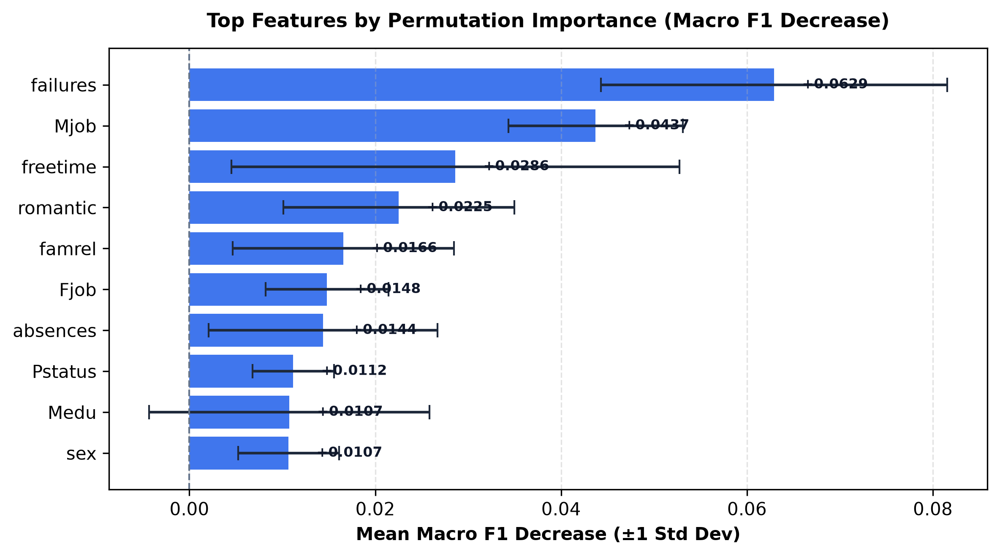
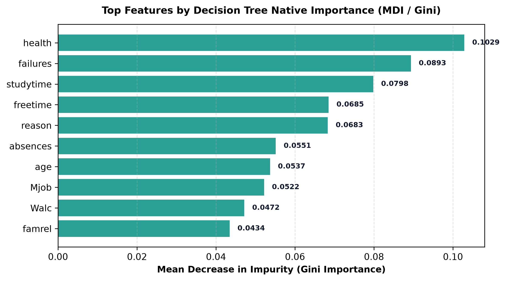

# AI-Based Student Performance Prediction System

YBI Foundation — Python AI & Data Science Internship · 45-day curriculum project

[](https://github.com/lightcode01-oss/IYB_INTERNSHIP/actions/workflows/tests.yml)

A Python portfolio application that estimates **Low**, **Medium** or **High** academic-performance categories from the public UCI Student Performance dataset. It includes a saved preprocessing/model pipeline, Streamlit interface, optional local API, validated CSV workflow, explanation dashboard and automated tests.

**Scope:** Learning demonstration using public research data. Do not use it to grade students, assess individual ability or determine educational access. Model probabilities are uncalibrated. **Deployment status: local application verified; no public hosting URL verified.**

## Quick start

Use Python 3.14 from the repository root:

```shell
python scripts/setup.py
```

Activate the generated `.venv` environment (`.venv\Scripts\Activate.ps1` on Windows PowerShell, or `source .venv/bin/activate` on macOS/Linux), then:

```shell
python -m streamlit run app.py --server.address 127.0.0.1
python -m pytest -q
```

Run the test command from the project root (the folder containing `app.py`). The tests also work in an extracted project ZIP; Git metadata is not required.

For the optional API, run `python -m uvicorn api:app --host 127.0.0.1 --port 8000` and open its local `/docs` page. See the [API contract](docs/API.md) and [demonstration guide](docs/DEMONSTRATION.md).

## Data and target

UCI dataset ID 320 provides 649 Portuguese-course records from two Portuguese secondary schools. The project preserves 30 predictor columns and the original stratified 519/130 train/test split (seed 42).

| Category | Final grade used only to define the label |
|---|---|
| Low | G3 < 10 |
| Medium | 10 <= G3 < 15 |
| High | G3 >= 15 |

G3, the derived category and intermediate grades G1/G2 are excluded from model input. The app never asks for the final grade. Preprocessing stays inside the ML pipeline. Public dataset attribution: Cortez, P. (2008), [UCI Student Performance](https://archive.ics.uci.edu/dataset/320/student+performance), DOI [10.24432/C5TG7T](https://doi.org/10.24432/C5TG7T), CC BY 4.0.

## Verified evaluation

The decision tree was selected using training-only five-fold stratified cross-validation with Macro F1. Its hyperparameters, original row split and every saved test prediction were verified.

| Measurement | Actual result |
|---|---:|
| Training CV Macro F1 | 0.5237 |
| Historical test Macro F1 | 0.4498 |
| Historical test accuracy | 53.85% |
| Majority-class baseline Macro F1 | 0.2617 |

These scores describe the historical 130-row evaluation set, which was inspected repeatedly during the project. They are not fresh external validation. See the [full evaluation and uncertainty report](reports/FINAL_MODEL_EVALUATION.md) and [data/model card](docs/DATA_AND_MODEL_CARD.md).

## Features and reliability

- Single-record and CSV prediction share one strict 30-field service; extra identifiers, target columns, invalid domains and missing/nonfinite values are rejected.
- CSV uploads are limited to 500 rows and 1 MiB, with duplicate-header and ragged-row checks. A [public demo CSV](data/demo_input.csv) is provided.
- The local API returns model identity and the same probabilities as the app. Model bytes are checked before trusted deserialization.
- Explainability includes raw-column permutation importance, native tree attribution and decision paths. Associations are not causal effects.
- Monitoring is off by default, keeps logs outside Git and distinguishes subjective feedback/output shift from accuracy. Thread locking applies within one process.
- Unit and integration tests cover app submission, API/CSV parity, schema failures, artifact integrity, monitoring concurrency and notebook execution state.

## Actual model visualizations





These are generated plots from actual model runs. No application screenshot is claimed; browser capture was unavailable during the completion session.

## Repository guide

| Location | Contents |
|---|---|
| Root Day 1–23 notebooks | Preserved original project notebook names, repaired and executed |
| notebooks/ | Day 24 onward, recovered or authored and executed |
| src/, app.py, api.py, pages/ | Reusable modules and interfaces |
| artifacts/ | Saved model, checksum, metadata, original split indices and version manifest |
| data/ | Public cached data and demonstration input; local monitoring is ignored |
| tests/, scripts/ | Regression checks, setup, notebook execution and local server verification |
| docs/, reports/ | Operating guides, daily evidence and final evaluation |

Start with the [daily notebook index](docs/NOTEBOOK_INDEX.md), [documentation index](docs/INDEX.md), [architecture](docs/ARCHITECTURE.md), [testing report](reports/FINAL_TEST_REPORT.md), [reproducibility guide](docs/REPRODUCIBILITY.md) and [development log](docs/DEVELOPMENT_LOG.md).

The 45 days represent curriculum milestones. Repairs and remaining milestones were executed during the 2 November 2026 completion session; the repository does not claim 45 separate elapsed calendar days, a certificate or mentor approval.
