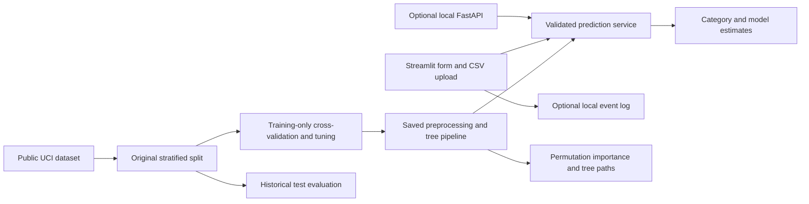

# Project architecture

| Component | Actual implementation | Responsibility |
|---|---|---|
| Data and split | src/dataset.py | Public cache, target definition, original 519/130 split |
| Training | Day 14–17 notebooks at repository root | Training-only CV/tuning, final evaluation and pipeline serialization |
| Input contract | src/validation.py, src/data_quality.py | Strict 30-field domains and row diagnostics |
| Serving | src/prediction.py | Trusted cached model, checksum and class probabilities |
| CSV workflow | src/batch.py | Bounded uploads, duplicate-header detection, ordered output |
| Interfaces | app.py, api.py | Streamlit and optional local HTTP transport |
| Evaluation | src/evaluation_dashboard.py, pages/2_Model_Performance_Dashboard.py | Real historical metrics and error breakdown |
| Explanation | src/explainability.py, pages/3_Model_Explainability.py | Raw-column permutation scores and tree paths |
| Monitoring | src/monitoring.py | Opt-in event logging, feedback and descriptive output shift |
| Verification | tests/, scripts/, .github/workflows/tests.yml | Unit/integration tests, local startup checks and CI |

The model artifact includes its preprocessing. G3, the derived label and intermediate grades are excluded from the serving schema. FastAPI and Streamlit reuse the service directly; Streamlit does not make a redundant HTTP call. Local CSV logging supports threads within one process. There is no production identity, shared datastore or public hosting claim.
